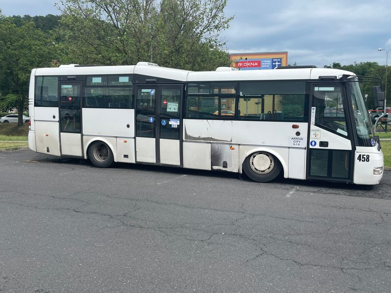
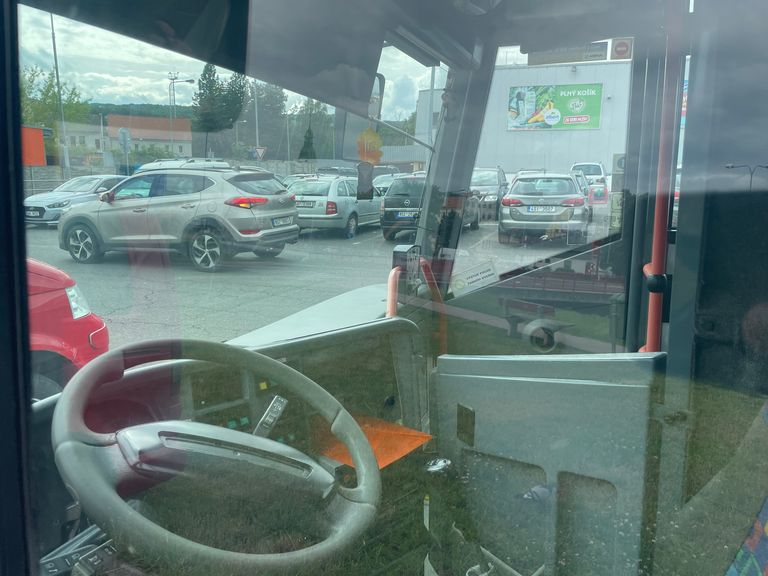

Zde jsou fotky, které jsem dneska vyfotil. Specificky vozu #458 z Teplické provozovny ARRIVA CITY s.r.o. v Bílině.

<figure class="gallery__item"><figcaption>SOR BN 10.5 #458 stojící na parkovišti obchodu Albert v Bílině s přední pravým kolem v karosérii. Pravděpodobně tlumič..?</figcaption></figure>

<figure class="gallery__item"><figcaption>Pohled na palubku řidiče, kde je vidět, že vůz je pravděpodobně vyřazen. Byla odstraněna kasa a tiskárna.</figcaption></figure>
