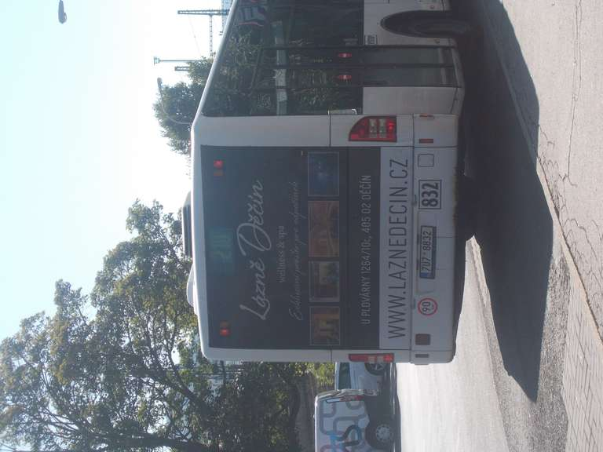
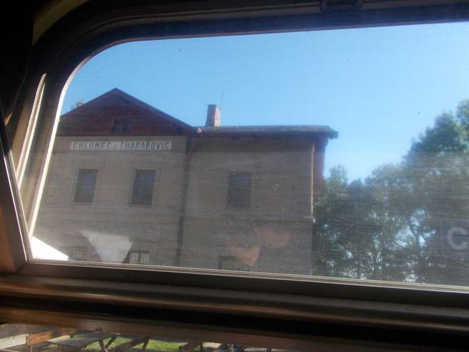
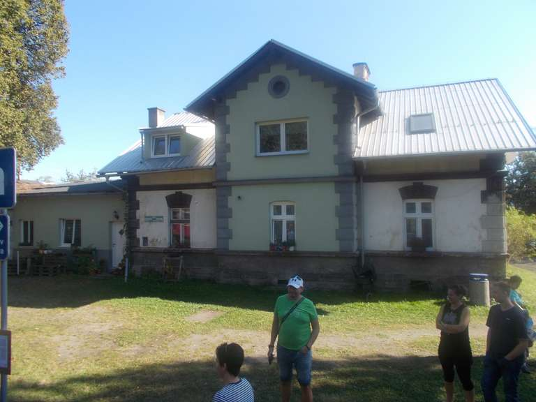
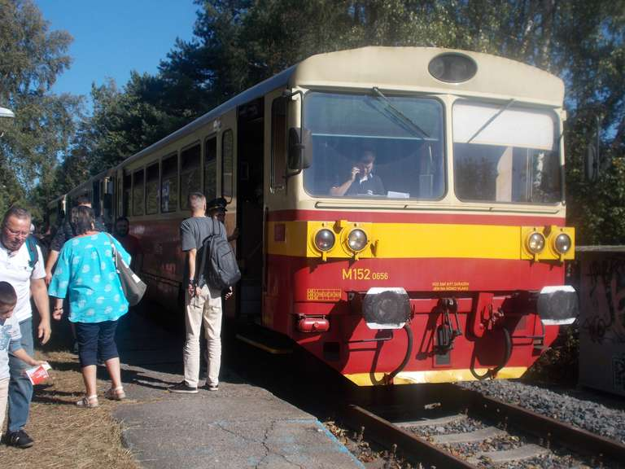
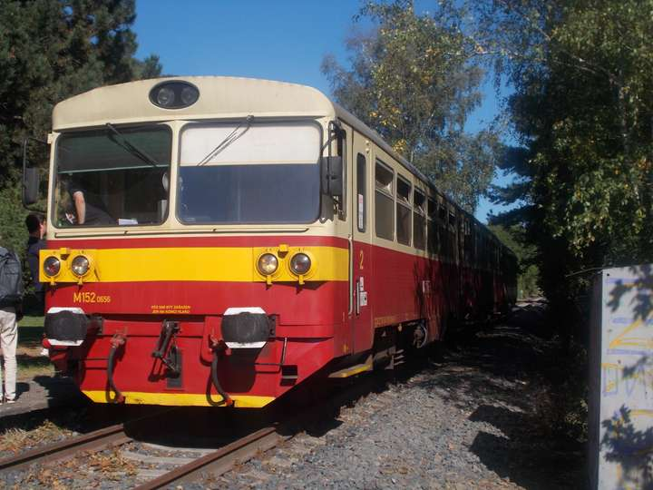

Ahoj! Zde jsou všechny fotky, které jsou ohledně spuštění "Kozí dráhy" do Krupky-město, které jsem vyfotil na Nikon Coolpix L29. Hodněkrát spíš fotím na mobil iPhone 12, případně na zrcadlovku Olympus OM-D E-M10 II, jenom na zrcadlovce nechce fungovat objektiv, takže zatím to mám jako držák papíru xD  
  
Pokuď budete chtít přispět na nový objektiv, můžete přes můj [ko-fi](https://ko-fi.com/vlastimilnovotny/goal?g=0)

<figure class="gallery__item"><figcaption>Autobus ev.č. 832 linky 210 v Děčíně s reklamou na Lázně Děčín zaparkovaný na ulici.</figcaption></figure>

<figure class="gallery__item"><figcaption>Výhled z vlaku na nádraží Chlumec u Chabařovic s nápisem na budově, zachycený přes okno vlaku.</figcaption></figure>

<figure class="gallery__item"><figcaption>Budova nádraží nebo zastávky (Pravděpodobně "Unčín") s několika lidmi před ní, zachycena za jasného dne.</figcaption></figure>

<figure class="gallery__item"><figcaption>Brzy doplněno</figcaption></figure>

<figure class="gallery__item"><figcaption>Brzy doplněno</figcaption></figure>
